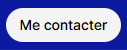

# Conformité de la PR #208

La branche `codex/fall26-parite` part du commit `04ea496` de la PR #207. Le [relevé préalable](FALL26-AUDIT.md) contient la matrice et les tolérances de comparaison.

## Composants et comportement

| Composant | Résultat vérifié |
| --- | --- |
| Bandeau | Hauteur de 50 px. Les commandes principales ont une hauteur de 34 px et une transition à 300 ms. Le contact passe de blanc à rgb(244,244,244) sans déplacement. |
| Chapitres et recherche | Les onze liens utilisent les destinations existantes. Sept fragments qui tombaient au même endroit conduisent désormais chacun au groupe de compétences associé. Entrée, clic, saisie et Échap rendent les commandes accessibles. La recherche conserve l'index des projets du CV. |
| Curseur | Formes natives pour les liens, la saisie, la prise et le redimensionnement. Suppression du pointeur DOM et du suivi ajouté pour les capsules des machines. |
| Cartes et liens | Filet de 1 px dessiné dans la surface de la carte. Fond à 8 % de blanc. Lien éditorial souligné au repos avec variation de contraste à 150 ms. Les coordonnées du moteur restent indépendantes du filet. |
| Actions machine | Capsules de 24 px sur ordinateur et cibles de 44 px pour le pointeur tactile. Les états occupé, désactivé et focus restent identifiables. Les callbacks des deux actions sont ceux des machines. |
| Défilement et 3D | Le défilement ordinaire poursuit la transition du héros. Chemin 3D s'active sur commande, comme l'Expo sur la référence. Le rejeu à 1 280 px ouvre le chemin, sélectionne les projets depuis le menu en 3D, puis revient à plat par Échap. |
| Pièce et rendu | Les effets de la pièce clonés depuis un ancien Three.js utilisent la méthode de visibilité de r187 dans le moteur hôte. La copie conserve les données de géométrie et le moteur ignore les objets hors champ comme avant. Le dock des commandes se synchronise avec les changements d'état et de scène. |

## Vérifications fonctionnelles

| Contrôle | Exécution et portée |
| --- | --- |
| Machines | Onze modules et 22 parcours de fiches Chromium. Les deux actions, l'étape, la pause, la reprise, l'inspection et la fermeture sont vérifiées. Les deux parcours Finance ont été rejoués après le dernier réglage des capsules. |
| Navigation | Menu et recherche en Chrome et Firefox, clavier et mouvement réduit. Chrome couvre les formats 1 920, 1 440, 1 280, 820 et 390 px. La vérification WebKit des commandes à 1 440 et 390 px utilise le transport HTTP de Playwright, le réseau direct de WebKit expirant sur cette machine. |
| Pages et scène | Article Finance, blog et expériences chargés. La pièce démarre et produit des images. Nacre s'ouvre, la commande Marcher s'active et la scène canvas reste visible pendant la saisie clavier. |
| Dépôt | Navigation sur 102 routes, métadonnées des projets, données des indicateurs et copie des géométries entre versions de Three.js. |

La CI GitHub valide Site integrity, la publication THALEOLITHIC et la construction des machines. Son scénario logiciel de fiche échoue avant la mesure de la capsule, qui est absente. Le même échec existe sur la tête de la PR #207. Le harnais précise désormais le projet et l'état de la page à cet échec. [CI de la PR #208](https://github.com/mathieu-comtesse/cv-mathieu_comtesse/actions/runs/43031645682) · [CI du point de départ](https://github.com/mathieu-comtesse/cv-mathieu_comtesse/actions/runs/43023197128)

## Captures comparatives

| Shopify | Site public avant intervention | Branche candidate |
| --- | --- | --- |
|  |  |  |

[Superposition des menus](fall26-evidence/menu-superposition.png) · [Superposition d'un repère de chapitre](fall26-evidence/chapitre-superposition.png)

Les mesures Chrome donnent un écart de 0 px en hauteur, de 0 ms sur la durée CSS et de 0 niveau de couleur sur le fond de survol des commandes du bandeau comparées. Les libellés étant différents, la superposition contient un écart de pixels autour du texte. Le lien éditorial reprend les 150 ms de la référence. La carte de contenu utilise la transparence observée et son angle carré. Sa hauteur dépend du contenu du CV.

## Performance

Mesures sur Chrome à 1 440 × 900 et Radeon RX 9070 XT, avec une impulsion de molette de 815 px. Le profil CPU attribue un blocage de 7 253 ms au premier passage de compilation synchrone des programmes WebGL de la pièce. La préparation asynchrone de la pièce et de l'aperçu ramène la plus longue tâche à 3 513 ms. En suspendant aussi le rendu de l'aperçu lorsque la transition le masque, la plus longue tâche descend à 504 ms. L'objectif de 60 FPS et la disparition des saccades à froid restent ouverts.

Dans le relevé isolé avant préparation des shaders, le P95 des images du scénario passe de 578 ms sur le site public à 55,6 ms sur la branche. Le P99 augmente de 578 ms à 7 957,6 ms à cause du premier rendu. Ce relevé ne représente pas la cadence en régime stable. Le relevé direct compte un écouteur `pointermove` sur `document` sur la branche, contre deux sur le site public. Les deux sites utilisent également des écouteurs dans d'autres éléments.

Les chargements et les compteurs d'octets du site public et du clone n'ont pas la même provenance réseau. Le test de fiches en SwiftShader valide les commandes sur rendu logiciel. Ses durées ne servent pas à estimer le débit d'images sur la Radeon.

## Rejouer la comparaison

Depuis le clone de la branche, avec Node.js et Playwright installés, définir `CHECKOUT` sur le répertoire du dépôt puis lancer `node tools/shopify/hover-parity.mjs`. Pour tester la production, retirer `CHECKOUT`. Le banc sert les fichiers disponibles du clone sous l'origine du site et charge les ressources absentes depuis le site public.

`ENGINE` sélectionne Chromium, Firefox ou WebKit. `CHANNEL=chrome` utilise Chrome installé. `VIEWPORT=1440x900` fixe la surface. `VIDEO=1` ajoute les séquences vidéo aux captures. `OUT` fixe le dossier des résultats. `report.json` contient les échantillons mesurés à 0, 50, 100, 200, 350, 500 et 800 ms et leur horodatage effectif.

## Écarts ouverts

La géométrie du chemin 3D, l'animation d'entrée de l'Expo, l'éclairage et la densité des constellations diffèrent encore de la référence. Le moteur et les polices historiques continuent de charger des dépendances Shopify. L'autorisation de réutiliser ces ressources commerciales n'est pas établie dans le dépôt. Les captures de comparaison servent de preuve de test et ne sont référencées par aucune page de l'expérience. [Inventaire des dépendances](CDN-SHOPIFY.md)

Le test de la pièce vérifie son lancement et ses images rendues. Il ne couvre pas chaque objet et activité. Le test Nacre couvre l'ouverture et une commande. Les autres jeux, les déplacements sur appareil tactile physique et l'intégralité des scénarios 3D dans Firefox et WebKit restent à vérifier.

