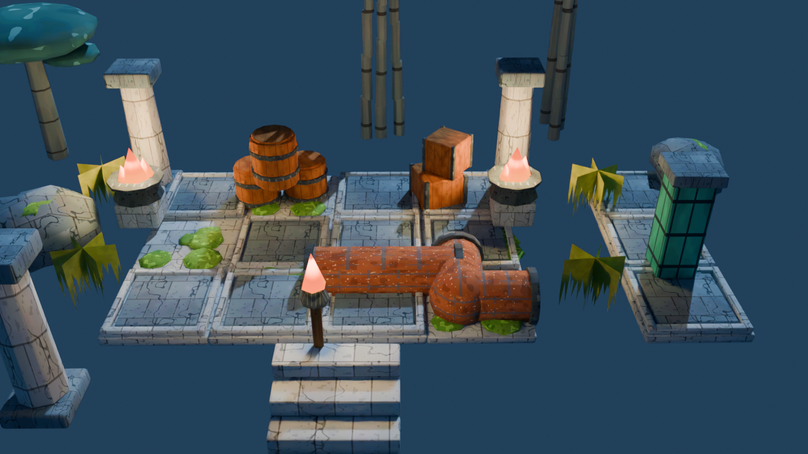

# Talas : style peint, Blender vers Unity

Ce dossier est un ajout au projet Unity de la branche `feat/talas-unity-refonte` (Unity 6000.3.26f1, URP 17.3). Il copie la méthode du cours « Construire son jeu dans Unity avec Claude » : chaque étape a une porte à valider en jouant, un commit par étape qui marche, un seul système par demande.

## Ce qui est prêt

| Pièce | Contenu |
|---|---|
| `tools/forge-unity/forge_kit.py` | forge Blender (module `bpy`) : 19 pièces modelées en code, atlas peint 1024, atlas d'émission, FBX, aperçu rendu |
| `Assets/TalasPainted/` | la sortie de la forge, déjà générée : `TalasPaintedKit.fbx`, `TalasPainted_Atlas.png`, `TalasPainted_Emission.png`, `TalasPaintedKit.json` |
| `Editor/TalasPaintedImport.cs` | menu **Talas/Peint/1** : réglages d'import, matériau URP à atlas, un préfabriqué par pièce, lumières des feux |
| `Editor/TalasPaintedLook.cs` | menu **Talas/Peint/2** : nuit bleue, brume, bloom, vignette, étalonnage froid (profil de volume) |
| `Editor/TalasPaintedDress.cs` | menu **Talas/Peint/3** : habille le quai des sept chapitres, sans collider, rejouable |
| `Tests/Editor/` | tests EditMode du kit (atlas, préfabriqués, matériau partagé, feux, profil d'ambiance) |

Non vérifié : je n'ai pas d'éditeur Unity ici (licence à activer sur ta machine). Les scripts C# sont lus syntaxiquement mais jamais compilés ni joués. La forge Blender, elle, a tourné : les pièces et l'aperçu ci-dessus viennent d'elle.

## Brancher Blender et Unity (sur ta machine)

1. Récupère le projet Unity : `git checkout feat/talas-unity-refonte -- talas-unity`, puis copie `talas-unity-style/Assets/TalasPainted` dans `talas-unity/Assets/`.
2. Pour régénérer le kit directement dans le projet : `pip install bpy`, puis  
   `python tools/forge-unity/forge_kit.py "<projet>/Assets/TalasPainted" apercu.png`  
   (Blender relance la forge en une dizaine de secondes ; l'aperçu prend ~1 min.)
3. Pour piloter l'éditeur avec Claude Code, installe le plugin Unity et la CLI comme décrit dans le cours, puis `unity status` doit répondre « ready ».

## Les portes, dans l'ordre

1. **Import** : menu Peint/1. Porte : 19 préfabriqués dans `Assets/TalasPainted/Prefabs`, tous sur `TalasPainted.mat`. Test Runner EditMode : `EveryPieceHasAPrefabOnTheSharedMaterial`.
2. **Ambiance** : menu Peint/2 sur la scène `Talas-Campagne`. Porte : bloom visible sur les braseros, brume, vignette ; test `LookProfileHasBloomAndVignette`.
3. **Habillage** : menu Peint/3. Porte : sept ateliers habillés, le joueur marche sans être bloqué (aucun collider ajouté).
4. **Preuve de jeu** : lance le contrôle automatique existant (`TalasCampaignQA`) : les douze épreuves doivent rester gagnables.
5. **Build WebGL** : `TalasWebShell` puis build ; remplace alors `talas-refonte/Build`.

Après deux échecs sur une porte : retour au dernier commit, et la demande est coupée en deux.

## État du site

Le jeu three.js (`jeux/village-talas-scene.html`) reste en ligne tant que le build Unity n'a pas passé la porte 5. Le retirer avant laisserait le site sans jeu jouable.

## Style

Références : pierre lunaire peinte à la main, mousse vive, tonneaux orange, cuivre à runes, torches chaudes, brume bleue. On décrit comment la pièce doit se sentir, la forge l'assemble : volumes bombés et légèrement tremblés, détail porté par la peinture de l'atlas, lumière froide avec des points chauds.
