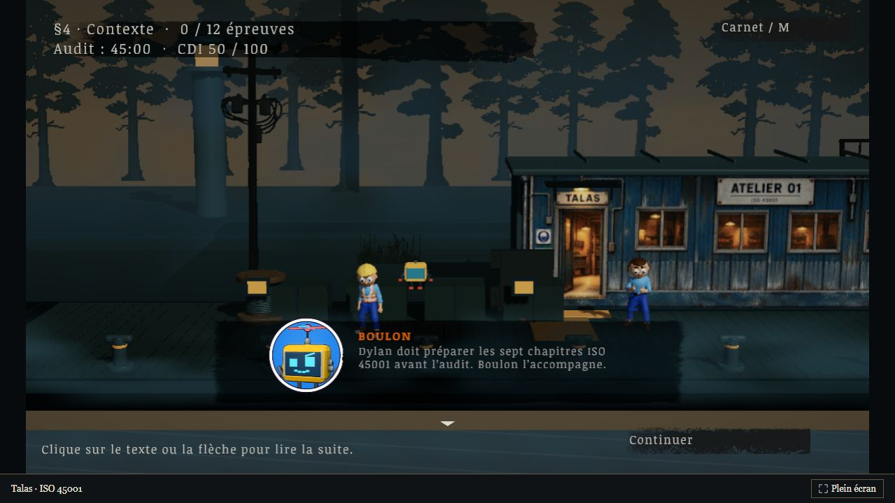

# Talas — Les sept ateliers

Refonte Unity de la campagne Talas autour de la prévention et des sept chapitres ISO 45001. Cette branche contient le projet éditable et la compilation navigateur validée le 12 octobre 2026.



## Jouer dans le navigateur

**[Jouer à Talas directement en ligne](https://mathieu-comtesse.github.io/cv-mathieu_comtesse/talas-refonte/)** — cliquer sur ce lien, attendre le chargement puis cliquer sur Continuer. Aucune installation ni serveur local à lancer.

La compilation intègre la décompression des ressources pour fonctionner sur GitHub Pages. La version publiée est dans `talas-refonte` sur la branche de publication ; les sources Unity restent ici.

### Option pour développer en local

Avec Python 3 installé, depuis ce dossier :

```sh
python serve-talas.py --root Navigateur --port 8189
```

Ouvrir ensuite <http://127.0.0.1:8189/>. Le serveur sert les fichiers en HTTP ; la compilation n’exige plus d’en-têtes de décompression spécifiques. Une ouverture directe du fichier HTML depuis le disque ne suffit pas.

Q/D ou flèches : marcher ; Maj : courir ; E : ouvrir l’atelier ; M : carnet. Les commandes propres à chaque activité sont présentées avant de commencer. Cliquer sur le texte, la flèche ou Continuer pour parcourir un dialogue.

## Ouvrir et compiler le projet

1. Installer Unity **6000.3.26f1**, avec les modules Windows et Web Build Support.
2. Ajouter ce dossier `talas-unity` dans Unity Hub. Laisser Unity restaurer les dépendances de `Packages/manifest.json` et importer les ressources.
3. Ouvrir `Assets/TalasScenes/Talas-Campagne.unity`.
4. Dans les profils de compilation, choisir Windows ou Web. La scène de campagne est déjà activée dans la liste des scènes.

Le projet inclut ses fichiers `.meta`, scènes, matériaux, shaders, six personnages avec leurs rigs, animations, accessoires et scripts de contrôle. Les caches Unity sont exclus. La compilation Windows validée reste dans la livraison locale sur E ; elle peut être reconstruite depuis ces sources.

## Contenu et validation

- Sept chapitres, douze sessions obligatoires, treize décisions et quinze activités : attrape, combat, fuite, budget, festin, deux karaokés, documentation, parcours, revue, opération, jetski, avions, pétanque et lanternes.
- Six personnages Talas : 23 os et 31 animations disponibles par personnage ; marche, combat et pose d’échec animés.
- Cadres, police et mise en page des dialogues étudiés depuis les fichiers Silver Pines fournis ; portraits et textes Talas. Certains éléments du décor et de l’interface proviennent de cette référence ou ont été retravaillés. Leur présence ne constitue pas une licence de redistribution accordée par leurs ayants droit.
- Eau animée, éclairage froid et lampes chaudes, brume volumétrique ; shader Talas adapté au navigateur. Budget Windows configuré à un million de triangles et un million de sommets par vue.
- Rapports et captures réels dans [Validation](Validation/Etat-local-valide.md) : quinze activités contrôlées dans Unity, sauvegarde et progression contrôlées, compilation Windows et navigateur sans erreur, interactions de campagne et premier mini-jeu vérifiés dans le navigateur.

Le rendu et la finesse des animations restent en dessous de Silver Pines. Les mécaniques de certaines activités ont été simplifiées. Les quinze activités n’ont pas toutes été jouées manuellement dans le navigateur ; les contrôles complets de campagne ont été réalisés dans Unity.

## Organisation

`Assets`, `Packages` et `ProjectSettings` constituent le projet Unity. `Navigateur` contient la compilation WebGL ; `Validation` conserve les preuves de la livraison locale. Les scripts de l’éditeur se trouvent notamment dans `Assets/TalasCampaign/Editor`.

La page d’accueil du CV et le Talas initial sont conservés. La publication ajoute le dossier `talas-refonte` et un README avec le lien jouable sur la branche servant GitHub Pages. Cette branche conserve le projet Unity et sa compilation navigateur.
