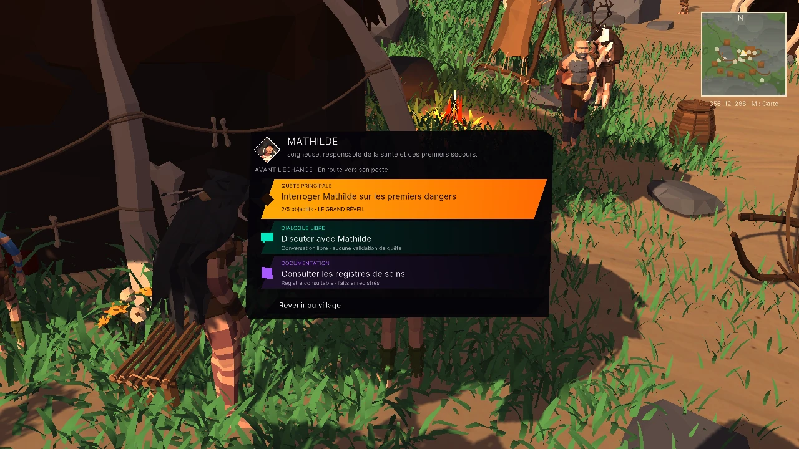
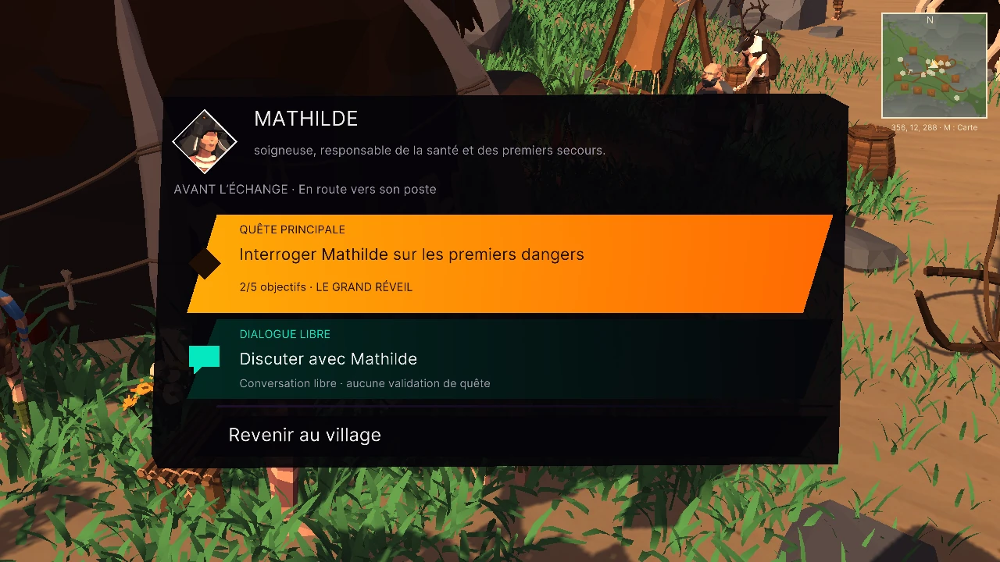

# THALEOLITHIC — version 0.13.0

## Livré

Nom public THALEOLITHIC, titre de campagne, en-tête des menus, produit Windows/Web, illustration et article du portfolio. Adresse canonique `/thaleolithic/`. Les anciens liens redirigent avec leurs paramètres et fragments. Les identifiants privés des données restent compatibles ; la migration copie une sauvegarde valide sans supprimer l’original ni écraser une sauvegarde déjà présente.

Le menu PNJ classe ses actions depuis la quête principale active : bandeau orange prioritaire, discussion cyan, documentation violette et états indisponibles distincts. Une étape terminée quitte la priorité. Le registre de Mathilde affiche les données réellement enregistrées et ne valide pas l’enquête. Les conversations libres et les actions de quête gardent leurs traitements propres.

Les listes d’actions sont mises en cache puis invalidées lors des changements de campagne ; l’exécution revérifie les conditions. Les portraits de dialogue ne rendent plus inutilement le personnage entier et son masque. Les profils graphiques sont initialisés aussi au clavier et à la souris.

Les six séquences existantes ont été contrôlées individuellement. Leur séquence active est sauvegardée avant lecture, la fin ou le passage sont enregistrés après restauration du monde, une interruption peut reprendre et une séquence achevée ne se rejoue pas automatiquement au chargement. L’événement natif de pas du mammouth dispose désormais d’un récepteur audio. Les sources et animations natives d’origine ne sont pas modifiées.

## Mesures et validation

37 contrôles de régression dédiés réussis dans l’éditeur, aucune erreur. Dans le nouvel exécutable Windows : 15 contrôles de déplacement, 47 de duel et 60 de progression/construction, tous réussis, sans erreur de jeu enregistrée. Les captures de Mathilde et les scénarios tardifs utilisent des fixtures explicites ; ils ne prétendent pas prouver une campagne entière.

Comparaison contrôlée du cache désactivé puis activé dans le même moteur corrigé, rendu explicite à 1280×720 sous Unity Editor, GPU AMD Radeon RX 9070 XT, CPU AMD Ryzen 9 7900X 12-Core Processor, plafond d’images désactivé pour les deux parcours. Temps du calcul des interactions à l’arrêt : 1.714 → 0.151 ms/image ; p95 2.595 → 0.200 ms. Allocations globales moyennes : 705.1 → 111.4 ko/image. Ce test isole surtout le coût du cache ; il n’établit pas une garantie de FPS pour tous les appareils.

Parcours physique rendu : 300.03 secondes, 395.1 mètres. Aucune erreur relevée. La phase immobile de 300 secondes présente dans `candidate-equivalent-performance.json` est exclue de la validation du déplacement ; le parcours valide est `walking-final-performance.json`. Le premier essai sans rendu continu est conservé uniquement dans les archives locales et n’est pas utilisé comme preuve graphique.

Le temps GPU, certaines catégories de navigation/animation et les collectes détaillées ne sont pas disponibles dans ces sondes. Un compteur non disponible n’est pas interprété comme zéro. Le thread principal inclut l’attente graphique et ne représente pas uniquement du calcul CPU.

Parcours navigateur joints : ancienne version → nouveau produit et nouvelle adresse → reprise de Dylan, position conservée ; nouvelle partie → ouverture jouée entièrement → retour au gameplay → reprise sans rediffusion ; affichage et commandes tactiles à 844×390. Le tactile est émulé dans Chromium, pas testé sur un téléphone physique. Les builds et leurs avertissements sont consignés dans les reçus joints.

## Limites restantes du cahier des charges

Cette révision ne livre pas une refonte complète des LOD, de l’IA distante, des regards/visages/IK, ni les nouveaux découpages premium C01–C06 demandés. Les identifiants C01–C06 conservent leur signification narrative actuelle. L’inspection 3D détaillée, le carnet d’analyse des causes et les nouvelles séquences de reconstruction restent à compléter ; les fenêtres documentaires ne les remplacent pas.

Les objectifs 60 FPS PC / 30 FPS smartphone sur appareils de référence et une partie complète de 45 minutes avec les trois fins ne sont pas déclarés validés. Aucun téléphone réel n’a été testé. Les assets récupérés conservent des avertissements hérités ; zéro erreur de compilation ne signifie pas zéro avertissement.

Ces sources facilitent la revue ; ce dossier n’est pas un projet Unity autonome contenant tous les assets.

