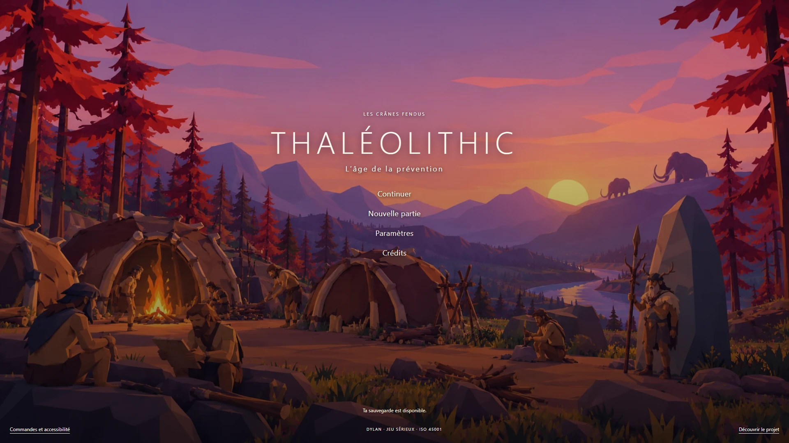
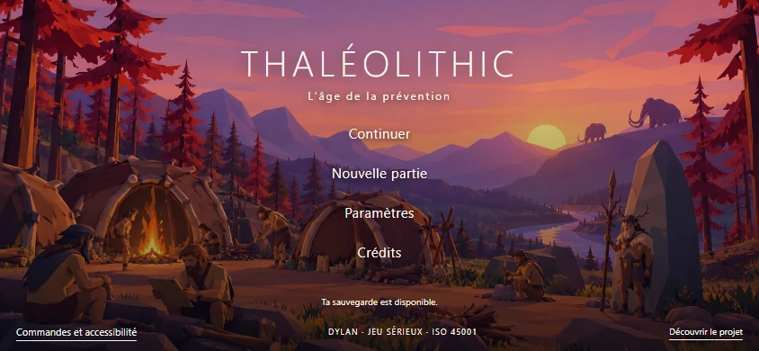

# THALÉOLITHIC — accueil low poly

L’accueil du navigateur présente un décor original sans texte. Le titre et les quatre commandes sont des éléments HTML accessibles, séparés de l’image. Le village Unity reste la version 0.11.0 ; aucune modification des animations, collisions, missions ou paramètres physiques n’est incluse dans cette correction d’accueil.

## Direction

Grandes faces anguleuses, personnages simplifiés, huttes brunes sur ossatures de bois, feu au sol, végétation en aplats, ombres violettes et lumière orange. Les deux références fournies par l’utilisateur et une capture du village jouable ont guidé la génération. Il s’agit d’une illustration originale, pas d’une capture du moteur ni de la reprise d’un écran propriétaire.

Image créée avec le mode intégré ImageGen, résolution source 1672 × 941. Export WebP à qualité 90 : 218 846 octets. Le PNG original et le prompt sont conservés localement dans Revision12/Art. La résolution source est inférieure aux 1920 × 1080 du brief initial ; les captures de l’interface à 1920 × 1080 ne changent pas cette résolution source.

## Comportement

- Continuer se débloque uniquement lorsqu’une sauvegarde existe.
- Nouvelle partie demande confirmation lorsqu’une sauvegarde risque d’être remplacée ; Annuler conserve cette sauvegarde.
- Paramètres règle les commandes et la qualité avant démarrage.
- Crédits ouvre une fenêtre distincte, fermable avec Échap et au toucher.

La route /unga-bunga-45001/, le nom de produit Unity et la société Talas restent stables pour conserver l’accès aux sauvegardes. Le titre public devient THALÉOLITHIC. Les données Unity et leurs empreintes sont inchangées.

Les demandes d’inspection physique et d’analyse des causes relèvent d’une modification distincte du moteur ; cet accueil ne les déclare pas réalisées.

## Validation dans le navigateur

Chargement réel du WebGL, démarrage de Dylan, nouvelle partie confirmée, reprise de sauvegarde avec écart de position nul, navigation Tab/Entrée/Espace/Échap, fermeture des fenêtres et commandes tactiles validés dans Chromium. Aucun événement pageerror ou console error du jeu lors de ces parcours. Tests de disposition à 1920 × 1080, 1280 × 720, 844 × 390 tactile, 568 × 320 et 390 × 844. Le tactile a été testé par émulation navigateur, pas sur un téléphone physique.

[Rapport des parcours](Validation/title-screen-validation.json) · [Prompt de génération](TITLE-SCREEN-PROMPT.txt)

